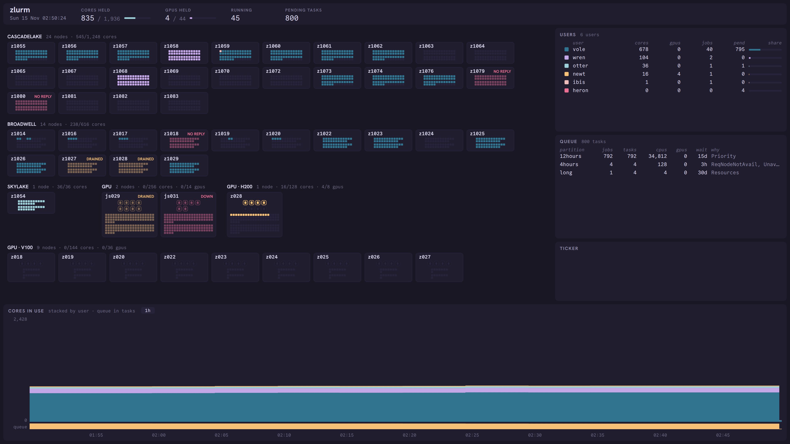
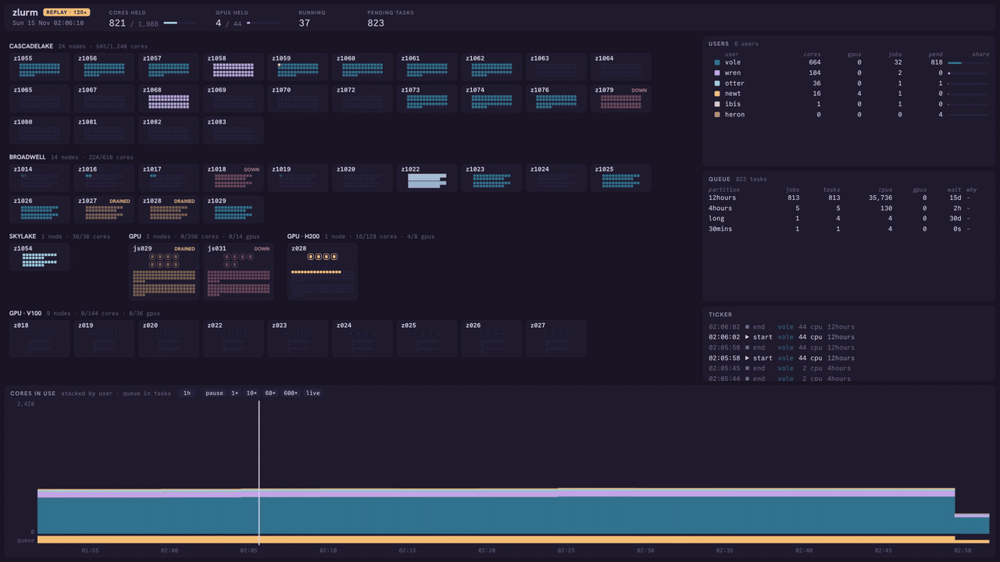
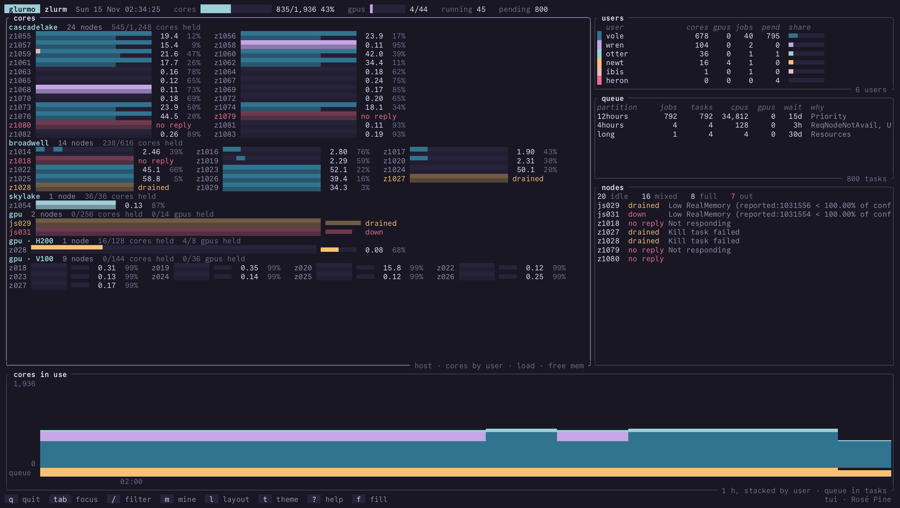

<h1 align="center"> glurmo</h1>

A live view of who holds which cores and GPUs on a Slurm cluster.



## Description

glurmo draws every core and GPU of a Slurm cluster in the color of the user who holds it. Panels beside the cores show users, the queue, node health and usage history.

* `glurmo serve` samples the cluster, keeps its history in SQLite, and streams the changes to a web view sized for a desk or a wall display.
* `glurmo tui` shows the same stream in a terminal.
* glurmo speaks Slurm's protocol to slurmctld and slurmdbd. It runs no Slurm commands, and one call places every core of every job.

glurmo only reads. It never acts on Slurm, and it shows no per-person efficiency, idle or failure counts.





Full-resolution videos: [web replay](docs/media/web-replay.mp4), [TV mode](docs/media/web-tv.mp4), [terminal](docs/media/tui.mp4). The users are pseudonyms.

## Getting Started

### Dependencies

* Linux on x86-64, on a host that can sign Slurm requests: with munged and the cluster's key for `auth/munge`, or with slurmd or sackd for `auth/slurm`.
* A Slurm controller from 23.11 through 27.05. glurmo is tested on 23.11 and 25.11.

### Installing

Download the static binary from the [latest release](https://github.com/ramirc0/glurmo/releases/latest), or build it with `just static`.

### Executing program

```
glurmo probe
glurmo serve
glurmo tui
```

Then open the server's address, `http://127.0.0.1:8765/` by default. The [guide](docs/guide.md) covers configuration, the views, keys, themes, layouts and recordings. [How glurmo talks to Slurm](docs/protocol.md) shows the architecture and the protocol.

## Help

```
glurmo --help
```

[Troubleshooting](docs/guide.md#troubleshooting) lists common problems.

## Authors

Christian Ramirez (christian.ramirez1@umassmed.edu)

## Version History

See [CHANGELOG.md](CHANGELOG.md).

## License

This project is licensed under the GNU General Public License, version 2 or later. See [LICENSE](LICENSE) for details.

## Acknowledgments

* The name comes from [Glurmo](https://theinfosphere.org/Glurmo), the foreman of the Slurm factory in [*Futurama*](https://en.wikipedia.org/wiki/Futurama).
* The node and job listing rules follow [pestat](https://github.com/OleHolmNielsen/Slurm_tools/tree/master/pestat).
* The wire format follows the source of [Slurm](https://github.com/SchedMD/slurm), [MUNGE](https://github.com/dun/munge) and [SSSD](https://github.com/SSSD/sssd).
* The default colors come from [Rosé Pine](https://rosepinetheme.com). The other themes come from [Tinted Theming](https://github.com/tinted-theming)'s base16 schemes.
* The web view uses [Hanken Grotesk](https://github.com/marcologous/hanken-grotesk) and [Commit Mono](https://commitmono.com), both under the SIL Open Font License.
