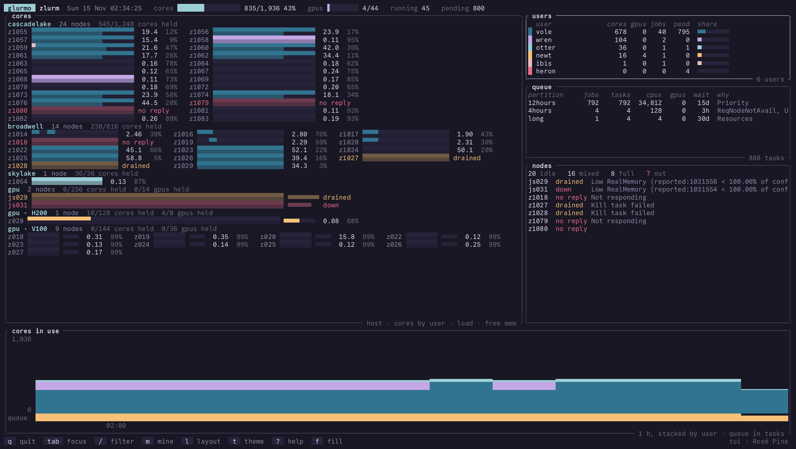

# Guide

## Install

Download `glurmo` from the [latest release](https://github.com/ramirc0/glurmo/releases/latest), or build it:

```
just static
cp target/x86_64-unknown-linux-musl/release/glurmo ~/.local/bin/
```

The binary is static and runs on any x86-64 Linux host. Building needs Rust 1.100 with the `x86_64-unknown-linux-musl` and `wasm32-unknown-unknown` targets, [just](https://github.com/casey/just) and [trunk](https://trunkrs.dev). `rust-toolchain.toml` pins the version. `just static` builds the web view first and embeds it in the binary.

The host must be able to sign requests as any Slurm client does: with munged and the cluster's key under `auth/munge`, or through slurmd's or sackd's socket under `auth/slurm`. glurmo finds the controller in slurm.conf, as Slurm's own tools do. A host without slurm.conf can name the controller in the config.

## Configure

Settings live in `~/.config/glurmo/config.ron`. Every field is optional.

```ron
Config(
    slurm: (backend: Wire, controller: ["ctl-1:6817"]),
    sample: (jobs: "10s", nodes: "30s", partitions: "10m", lookups: 25),
    store: (keep: Forever, backfill: Days(30)),
    server: (listen: "127.0.0.1:8765"),
    tui: (server: "http://head:8765", layout: "tui", theme: "rose-pine", me: "otter"),
    names: FullName,
    gpu_models: {"gpu": "V100", "gpuh200": "H200"},
)
```

* `slurm` picks the backend. `Wire` speaks Slurm's protocol. `Cli` runs `squeue`, `sinfo`, `scontrol`, `sdiag` and `sacct` instead, for a cluster newer than the protocol glurmo knows. `controller` overrides the addresses in slurm.conf.
* `sample` sets how often each kind of data is read. `lookups` caps placement lookups per tick, and only the `Cli` backend makes them.
* `store` keeps history in a SQLite file, `$XDG_STATE_HOME/glurmo/<cluster>.sqlite` by default, with a nightly copy in `$XDG_DATA_HOME/glurmo`. The file must sit on a local disk, because SQLite locks are unreliable on NFS, Ceph or Lustre. Where the home directory is on one of those, set `XDG_STATE_HOME` to a local disk, or name the file with `path`. `backfill` reads that much history from accounting into a new store. A TimescaleDB server can hold history in place of the file, as described below.
* `tui` picks the server the terminal view follows and its first layout and theme. `me` names whose jobs `m` and the `Mine` panel show, in place of `$USER`.
* `names` shows full names from the account database, or logins with `Login`.
* `gpu_models` names the GPUs in each partition, for clusters whose GRES lists no GPU type.

### History on TimescaleDB

A TimescaleDB server can hold history in place of the SQLite file. `timescale` takes the place of `path` and names the server with a PostgreSQL connection string. Setting both is an error.

```ron
store: (timescale: "host=/run/postgresql user=glurmo dbname=glurmo", keep: Forever, backfill: Days(30)),
```

#### The server

The server needs PostgreSQL 16 to 18 and TimescaleDB 2.29.2 or later. Earlier releases can miss open attempts in compressed chunks. glurmo is tested with TimescaleDB 2.31. The server must load the extension at start, in `postgresql.conf` or on its command line:

```
shared_preload_libraries = 'timescaledb'
```

A site without one can run the `timescale/timescaledb` image under Apptainer, with a Unix socket and no TCP port:

```sh
dir="${XDG_DATA_HOME:-$HOME/.local/share}/glurmo/timescaledb"
mkdir -p "$dir"
apptainer pull "$dir/timescaledb-2.31.0-pg18.sif" docker://timescale/timescaledb:2.31.0-pg18
apptainer exec --bind "$dir" "$dir/timescaledb-2.31.0-pg18.sif" initdb -D "$dir/data"
```

`systemd/glurmo-timescaledb.service` runs the server, with its socket in `$XDG_RUNTIME_DIR/glurmo-timescaledb`, so the connection string's host is that directory. Install it as `systemd/glurmo.service` is installed. Then order glurmo after it with a drop-in, `~/.config/systemd/user/glurmo.service.d/timescaledb.conf`:

```ini
[Unit]
After=glurmo-timescaledb.service
Wants=glurmo-timescaledb.service
```

#### The role and the database

Give glurmo a role of its own that owns its database. It needs no superuser rights. As a superuser:

```sql
CREATE ROLE glurmo LOGIN;
CREATE DATABASE glurmo OWNER glurmo;
```

glurmo creates its tables at its first start, and the `timescaledb` extension when the database lacks it. The extension is trusted, so the database's owner may create it.

Over a Unix socket, peer authentication lets an operating-system user log in as the role of the same name. To log in as `glurmo` from another account, map it in `pg_ident.conf`, and use the map in `pg_hba.conf` above the line for all databases. Then reload the server:

```
# pg_ident.conf
glurmo          you                     glurmo

# pg_hba.conf
local   glurmo          glurmo                                  peer map=glurmo
```

Over TCP, put `password=` in the connection string, and keep the config file readable by you alone. glurmo does not read `~/.pgpass`. The connection uses no TLS, so keep it on a network you trust.

#### Limits

A statement fails after 5 minutes, and a wait on a lock after 30 s. A failed write opens a gap, which accounting fills once writes work again. To change the limits, set them in the connection string's `options`, such as `options='-c lock_timeout=10s'`. Over TCP, a server that stops answering fails a call within a minute.

#### Upkeep

* Attempts and usage bins are hypertables in 30-day chunks. Chunks older than 7 days are compressed where the server's license covers compression. The Apache-licensed build keeps them uncompressed, and glurmo says so once.
* `keep` prunes old history, as it does in SQLite.
* glurmo makes no nightly copy of this store. `systemd/glurmo-backup.timer` runs `glurmo-backup.service`, which dumps it nightly to `~/.local/share/glurmo/glurmo.dump` with `pg_dump`.

#### Moving from SQLite

A new database backfills from accounting as far as `backfill` reaches, as a new SQLite store does. Accounting keeps no placements and no node health, so history from before the new store has neither.

To keep them, copy the SQLite store into the empty database before glurmo first starts on it:

```sh
glurmo copy STORE.sqlite "host=/run/postgresql user=glurmo dbname=glurmo"
```

It prints each table's row count on both sides. The server on SQLite may keep running meanwhile. A copy that fails leaves the database empty, so it can run again. A server started on the copy fills the time since the copy from accounting, and users keep their colors.

## Run

Check what the cluster allows and what each call costs the controller:

```
glurmo probe
```

Run the server. `systemd/glurmo.service` runs it as a user unit, and its header says how to install it.

```
glurmo serve
```

Follow a server in the terminal, or the server that the config names. Without a server, `--embedded` samples the cluster in-process and backfills the last day. `--me` shows another login's jobs as yours, as `?me=` does on the web.

```
glurmo tui --server http://head:8765
glurmo tui
glurmo tui --embedded
glurmo tui --me otter
```

## Web view


Open the server's address, such as `http://head:8765/`. The address can pick a layout, a theme and a viewer:

```
http://head:8765/?layout=tv&theme=rose-pine-dawn
http://head:8765/?me=otter
```

* `me` fills the `Mine` panel.
* The `tv` layout, or `tv` in the address, hides the cursor and lights up each user's cores in turn.


* Hovering a user, partition or node row lights up its cores. Hovering a core shows its job, and hovering a node shows its state.
* `t` and `l` cycle themes and layouts. `f` fills the screen with the panel under the pointer, and `f` or `esc` brings the layout back.

The `Jobs` panel lists running and pending jobs:

* Jobs from one user that share a name, an array or partitions collapse into one row, and a click opens it.
* Its heading searches user, full name, job ID, name, partition, node and reason. Its chips narrow it to running, pending, your own or GPU jobs.
* A click on a column heading sorts by it.
* Hovering a row lights its cores. Hovering a core lights its job's row, and hovering a node lights the rows of every job on it.
* At 1,200 pixels wide it adds full names, time left and submit times. The `jobs` layout sets it beside the cores.


The history panel is a timeline:

* The wheel pans it back. Shift or ctrl with the wheel, or a pinch, zooms it around the pointer. A drag highlights a stretch, and letting go zooms to it. A white line marks the moment under the pointer, with its time.
* Type a span such as `6h` or `3d` in its heading, and *now* brings it back.
* A click replays the cluster from that moment, paused. The heading then offers 1×, 10×, 60× and 600×, pause and *live*. The keys `1` to `4`, `0` and `esc` do the same.
* The address can start a replay too, as in `?at=1794700000&speed=60`.
* A replay shows no load, free memory, pending reasons or job names, because the history does not keep them.

Press `e` to edit the layout and theme on the live page:

* Click a panel to pick it, then split, remove or change it in the sidebar. Drag a panel onto another to swap them, and drag the gap between panes to resize them.
* The theme side has a color picker for every color and imports a pasted base16 scheme.
* *Save in this browser* keeps the result in local storage. *Export RON* gives the file to save in the configuration directory.
* `e` or `esc` closes the editor and drops unsaved changes.

## Terminal view



| Key | Action |
| --- | --- |
| `q` | Quit |
| `tab` | Focus the next panel |
| `↑` `↓` `j` `k` | Scroll the focused panel |
| `/` | Filter by words that must all appear in a user, partition, node, job ID, job name or reason |
| `m` | Show only your jobs, or everyone again |
| `f` | Fill the screen with the focused panel, or show the layout again |
| `esc` | Clear the filter, then the fill |
| `l` | Next layout |
| `t` | Next theme |
| `?` | Help |

The terminal view writes its messages to `~/.local/state/glurmo/tui.log`. In embedded mode the history panel stays empty until the first five-minute bin closes.

## Themes and layouts


Themes and layouts are RON files. The built-in themes are `rose-pine`, `rose-pine-moon` and `rose-pine-dawn`, plus 20 base16 schemes such as `catppuccin-mocha`, `gruvbox-light` and `tokyo-night-dark`. The built-in layouts are `tui`, `web`, `tv` and `jobs`.

A file in `~/.config/glurmo/themes/` or `~/.config/glurmo/layouts/` adds one, or replaces the built-in of the same name. Views reload them within 2 seconds of an edit. See `themes/` and `layouts/` for the format.

## Recordings

* `glurmo record --minutes 30 OUT.jsonl` saves each call to Slurm and its answer. `--pseudonymize` rewrites logins, job names, free-text reasons and errors.
* `glurmo pseudonymize RAW OUT` rewrites a recording made without it.
* `glurmo serve --replay FILE` serves a recording with a throwaway history. `--speed 10` plays it ten times faster.
* `glurmo convert OLD NEW` turns a recording of command output, made before glurmo spoke the protocol, into one of calls and answers.

## Troubleshooting

* A red banner in the header means the server or Slurm stopped answering. It says since when and why. The web view reconnects on its own and catches up without reloading.
* A controller older than 23.11 or newer than 27.05 rejects glurmo's protocols, so `glurmo probe` fails there. Set `slurm: (backend: Cli)`.
* Without munged or a sack socket, glurmo cannot sign requests and exits at once. With munged but the wrong key, every call fails with a munge error.
