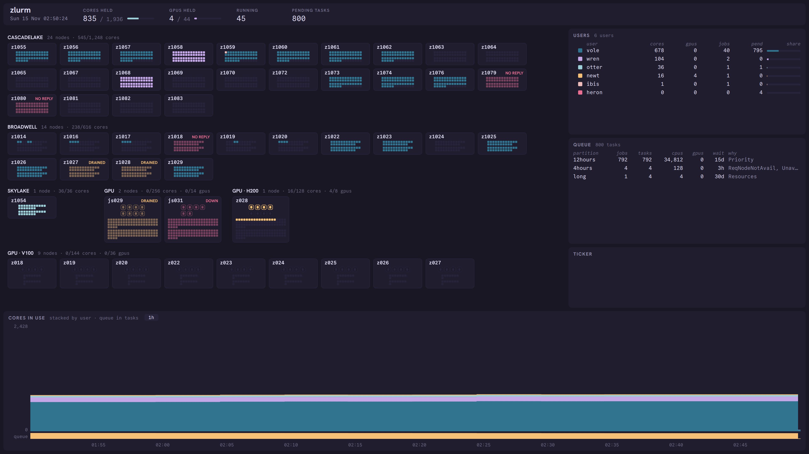
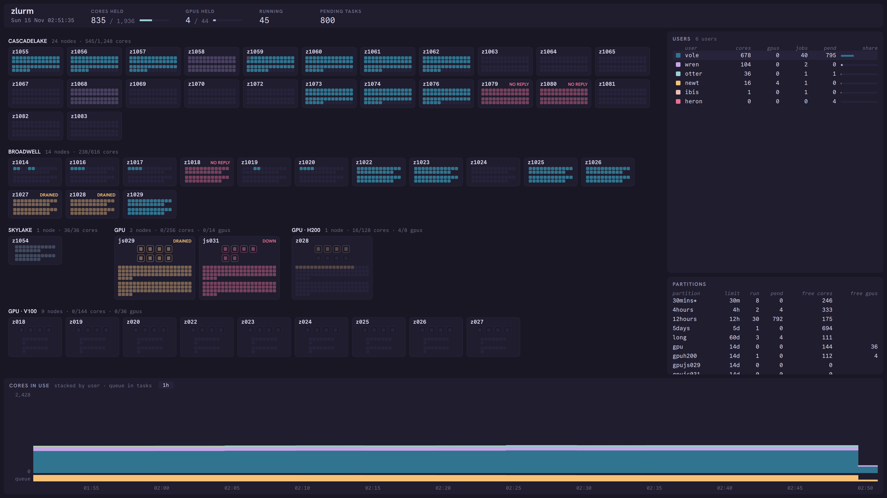
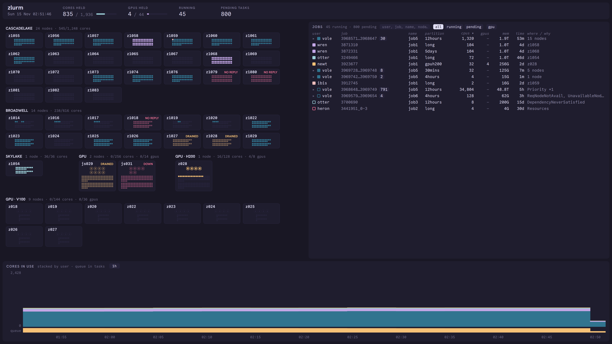
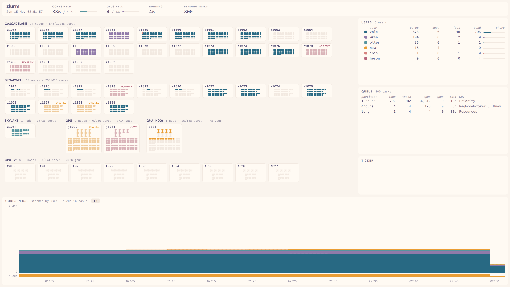

# Guide

## Install

Download `glurmo` from the [latest release](https://github.com/ramirc0/glurmo/releases/latest), or build it:

```
just static
cp target/x86_64-unknown-linux-musl/release/glurmo ~/.local/bin/
```

The binary is static and runs on any x86-64 Linux host. Building needs Rust 1.100 with the `x86_64-unknown-linux-musl` and `wasm32-unknown-unknown` targets, [just](https://github.com/casey/just) and [trunk](https://trunkrs.dev). `rust-toolchain.toml` pins the version. `just static` builds the web view first and embeds it in the binary.

The host must be able to sign requests as any Slurm client does: with munged and the cluster's key under `auth/munge`, or through slurmd's or sackd's socket under `auth/slurm`. glurmo finds the controller in slurm.conf, as Slurm's own tools do. A host without slurm.conf can name the controller in the config.

## Configure

Settings live in `~/.config/glurmo/config.ron`. Every field is optional.

```ron
Config(
    slurm: (backend: Wire, controller: ["ctl-1:6817"]),
    sample: (jobs: "10s", nodes: "30s", partitions: "10m", stats: "60s", lookups: 25),
    store: (path: "/scratch/you/glurmo/cluster.sqlite", keep: Forever, backfill: Days(30)),
    server: (listen: "127.0.0.1:8765"),
    tui: (server: "http://head:8765", layout: "tui", theme: "rose-pine"),
    names: FullName,
    gpu_models: {"gpu": "V100", "gpuh200": "H200"},
)
```

* `slurm` picks the backend. `Wire` speaks Slurm's protocol. `Cli` runs `squeue`, `sinfo`, `scontrol`, `sdiag` and `sacct` instead, for a cluster newer than the protocol glurmo knows. `controller` overrides the addresses in slurm.conf.
* `sample` sets how often each kind of data is read. `lookups` caps placement lookups per tick, and only the `Cli` backend makes them.
* `store` must sit on a local disk, such as `/scratch`. SQLite locks are unreliable on NFS, Ceph or Lustre. `backfill` reads that much history from accounting into a new store.
* `names` shows full names from the account database, or logins with `Login`.
* `gpu_models` names the GPUs in each partition, for clusters whose GRES lists no GPU type.

## Run

Check what the cluster allows and what each call costs the controller:

```
glurmo probe
```

Run the server. `systemd/glurmo.service` runs it as a user unit, and its header says how to install it.

```
glurmo serve
```

Follow a server in the terminal, or the server that the config names. Without a server, `--embedded` samples the cluster in-process and backfills the last day.

```
glurmo tui --server http://head:8765
glurmo tui
glurmo tui --embedded
```

## Web view



Open the server's address, such as `http://head:8765/`. The address can pick a layout, a theme and a viewer:

```
http://head:8765/?layout=tv&theme=rose-pine-dawn
http://head:8765/?me=otter
```

* `me` fills the `Mine` panel.
* The `tv` layout, or `tv` in the address, hides the cursor and lights up each user's cores in turn.



* Hovering a user, partition or node row lights up its cores. Hovering a core shows its job, and hovering a node shows its state.
* `t` and `l` cycle themes and layouts. `f` fills the screen with the panel under the pointer, and `f` or `esc` brings the layout back.

The `Jobs` panel lists running and pending jobs:

* Jobs from one user that share a name, an array or partitions collapse into one row, and a click opens it.
* Its heading searches user, full name, job ID, name, partition, node and reason. Its chips narrow it to running, pending, your own or GPU jobs.
* A click on a column heading sorts by it.
* Hovering a row lights its cores. Hovering a core lights its job's row, and hovering a node lights the rows of every job on it.
* At 1,200 pixels wide it adds full names, time left and submit times. The `jobs` layout sets it beside the cores.



The history panel is a timeline:

* The wheel pans it back. Shift or ctrl with the wheel, or a pinch, zooms it around the pointer. A drag highlights a stretch, and letting go zooms to it. A white line marks the moment under the pointer, with its time.
* Type a span such as `6h` or `3d` in its heading, and *now* brings it back.
* A click replays the cluster from that moment, paused. The heading then offers 1×, 10×, 60× and 600×, pause and *live*. The keys `1` to `4`, `0` and `esc` do the same.
* The address can start a replay too, as in `?at=1794700000&speed=60`.
* A replay shows no load, free memory, pending reasons or job names, because the history does not keep them.

Press `e` to edit the layout and theme on the live page:

* Click a panel to pick it, then split, remove or change it in the sidebar. Drag a panel onto another to swap them, and drag the gap between panes to resize them.
* The theme side has a color picker for every color and imports a pasted base16 scheme.
* *Save in this browser* keeps the result in local storage. *Export RON* gives the file to save in the configuration directory.
* `e` or `esc` closes the editor and drops unsaved changes.

## Terminal view


| Key | Action |
| --- | --- |
| `q` | Quit |
| `tab` | Focus the next panel |
| `↑` `↓` `j` `k` | Scroll the focused panel |
| `/` | Filter by user, partition or job name |
| `m` | Show only your jobs, or everyone again |
| `f` | Fill the screen with the focused panel, or show the layout again |
| `esc` | Clear the filter, then the fill |
| `l` | Next layout |
| `t` | Next theme |
| `?` | Help |

The terminal view writes its messages to `~/.local/state/glurmo/tui.log`. In embedded mode the history panel stays empty until the first five-minute bin closes.

## Themes and layouts



Themes and layouts are RON files. The built-in themes are `rose-pine`, `rose-pine-moon` and `rose-pine-dawn`, plus 20 base16 schemes such as `catppuccin-mocha`, `gruvbox-light` and `tokyo-night-dark`. The built-in layouts are `tui`, `web`, `tv` and `jobs`.

A file in `~/.config/glurmo/themes/` or `~/.config/glurmo/layouts/` adds one, or replaces the built-in of the same name. Views reload them within 2 seconds of an edit. See `themes/` and `layouts/` for the format.

## Recordings

* `glurmo record --minutes 30 OUT.jsonl` saves each call to Slurm and its answer. `--pseudonymize` rewrites logins and job names.
* `glurmo pseudonymize RAW OUT` rewrites a recording made without it.
* `glurmo serve --replay FILE` serves a recording with a throwaway history. `--speed 10` plays it ten times faster.
* `glurmo convert OLD NEW` turns a recording of command output, made before glurmo spoke the protocol, into one of calls and answers.

## Troubleshooting

* A red banner in the header means the server or Slurm stopped answering. It says since when and why. The web view reconnects on its own and catches up without reloading.
* A controller older than 23.11 or newer than 27.05 rejects glurmo's protocols, so `glurmo probe` fails there. Set `slurm: (backend: Cli)`.
* Without munged or a sack socket, glurmo cannot sign requests and exits at once. With munged but the wrong key, every call fails with a munge error.
