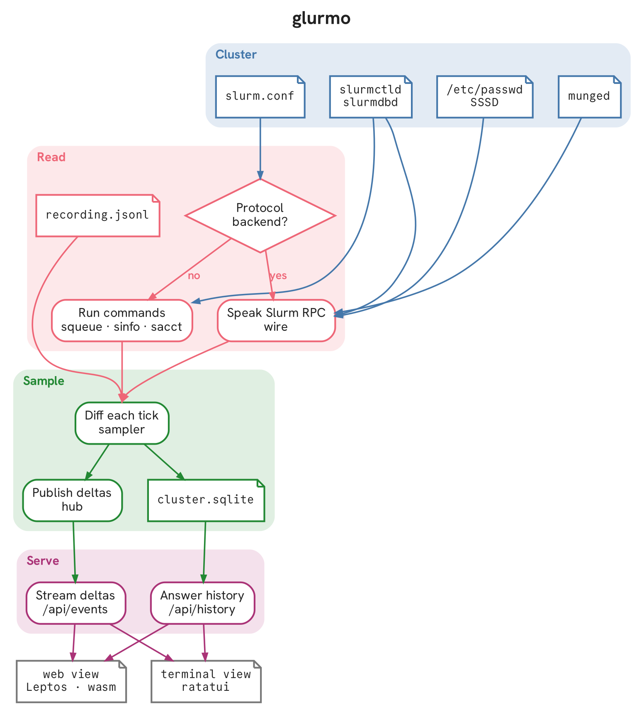

# How glurmo talks to Slurm

glurmo speaks Slurm's RPC protocol to slurmctld and slurmdbd, as `squeue` and `sacct` do. It runs no Slurm commands, and a static musl binary needs no Slurm install.



`docs/architecture.gv` holds the diagram's Graphviz source.

## Transport

* A message is a 32-bit length, a header, a munge credential and a body. Integers are big-endian, and strings carry a length that counts their NUL.
* glurmo asks the local munged for each credential over its socket. On Linux, munged reads the caller's UID from the socket, so one request and one reply suffice.
* The credential's hash uses Slurm's "none" type, so a controller with `CommunicationParameters=block_zero_hash` refuses glurmo.
* glurmo speaks Slurm 23.11's protocol. A controller answers in the client's version and, per Slurm's source, accepts 23.11 through 25.05. A newer cluster needs new decoders, or the command backend.

## Calls

| Data | Message | Cost on a 900-job cluster |
| --- | --- | --- |
| Configuration | `REQUEST_BUILD_INFO` | 1 ms |
| Jobs, with every core placement | `REQUEST_JOB_INFO` with `SHOW_DETAIL` | 9 to 17 ms, about 800 KB |
| One job | `REQUEST_JOB_INFO_SINGLE` | under 1 ms |
| Nodes | `REQUEST_NODE_INFO` and `REQUEST_PARTITION_INFO` | 16 ms |
| Partitions | `REQUEST_PARTITION_INFO` | 8 ms |
| Scheduler counters | `REQUEST_STATS_INFO` | 1 ms |
| Accounting | `DBD_GET_JOBS_COND` over a slurmdbd connection | 100 ms for an hour |

`scontrol -d show job` takes from 0.2 s to 1.4 s for the same placements. One job-info call places every job, so the sampler places every start on the tick it appears.

## What glurmo reads where

* The controller's address comes from `SlurmctldHost` and `SlurmctldPort` in slurm.conf. glurmo looks for it at `$SLURM_CONF`, `/etc/slurm/slurm.conf` and `/run/slurm/conf/slurm.conf`. Everything else comes from the configuration reply.
* Node info lists no partitions. Membership comes from each partition's node bitmap, and nodes in no partition are left out, as sinfo leaves them out.
* Logins come from each job's UID, as squeue's do, because the controller's own name for a UID can differ. glurmo reads `/etc/passwd`, then asks SSSD over `/var/lib/sss/pipes/nss`. Without SSSD, it runs `getent passwd`.

## Checking the decoders

Each decoder reads every field of Slurm 23.11's layout in order, so one wrong field shifts all that follow. The live tests compare every call with the command backend on a real cluster:

```
cargo test -- --ignored wire::tests
```

## Recordings

A recording holds one JSON line per call: when it was made, the call, and the answer as glurmo's model types or the error. Test fixtures are pseudonymized recordings.
